# Web Application Firewall Home Lab - SafeLine WAF Protecting DVWA

## Description

Home lab that puts **SafeLine**, a free web application firewall (WAF), in front of **DVWA** (Damn Vulnerable Web Application), a deliberately insecure web app. SafeLine runs as an HTTPS reverse proxy on an Ubuntu web server, and a Kali Linux VM plays the attacker. The lab covers reverse-proxy and TLS setup, a custom deny rule that blocks a malicious IP, HTTP flood protection, and reviewing the results in the WAF's statistics.

## Overview

A web application firewall sits between users and a web application. It inspects every HTTP(S) request and blocks malicious traffic before it reaches the application. This lab builds that setup from scratch on VirtualBox: a vulnerable application, a WAF in front of it, and an attacker machine to test it.

**Goal:** practise the prevention side of security operations: put a WAF in front of a vulnerable application, publish the application only over HTTPS through the WAF, and verify that WAF rules stop unwanted traffic.

**Scope:** SafeLine as an HTTPS reverse proxy with a self-signed certificate, a custom IP deny rule, HTTP flood (rate-limit) protection, and the attack statistics dashboard.

> ⚠️ **Safety note:** DVWA is intentionally vulnerable. Run it only on an isolated Host-Only network, never expose it to the internet, and only attack machines you own.

## Architecture

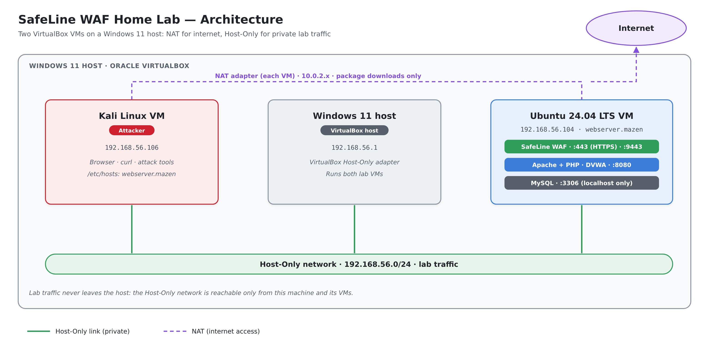

| Machine                 | Role                                   | Host-Only IP      |
|-------------------------|----------------------------------------|-------------------|
| Windows 11 host         | VirtualBox host                        | 192.168.56.1      |
| Kali Linux VM           | Attacker                               | 192.168.56.106    |
| Ubuntu 24.04 LTS VM     | SafeLine WAF + Apache, PHP, MySQL, DVWA | 192.168.56.104 (`webserver.mazen`) |

Both VMs have two network adapters: **NAT** for internet access, to download packages, and **Host-Only** for the private network between the VMs and the Windows host, which carries all lab traffic. See [`docs/virtualbox-network-setup.md`](docs/virtualbox-network-setup.md).

### How the reverse proxy works

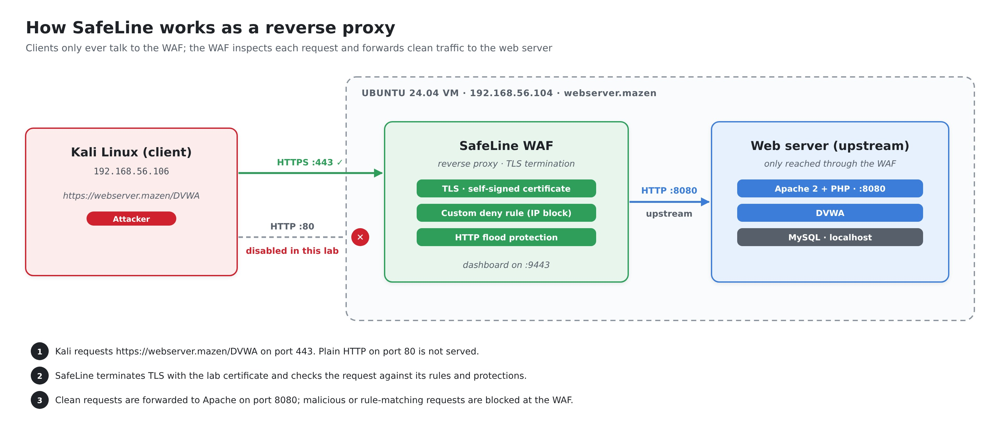

| Connection              | Port / protocol | Status in this lab |
|-------------------------|-----------------|--------------------|
| Kali → SafeLine         | 443 / HTTPS     | ✅ Allowed          |
| Kali → SafeLine         | 80 / HTTP       | ❌ Disabled, HTTPS only |
| SafeLine → Apache (DVWA)| 8080 / HTTP     | ✅ Upstream (backend) |

Apache is moved from port 80 to **8080**, so SafeLine can take over ports 80/443 on the same VM. Users always connect to SafeLine, which terminates TLS, inspects the request, and forwards clean traffic to Apache on port 8080.

## Tools and Technologies

| Area                 | Tool                                              |
|----------------------|---------------------------------------------------|
| Virtualization       | Oracle VirtualBox                                  |
| Web application firewall | SafeLine WAF (Chaitin Tech), community edition |
| Vulnerable app       | DVWA (Damn Vulnerable Web Application)            |
| Web stack            | Ubuntu 24.04 LTS, Apache 2, PHP, MySQL            |
| Attacker             | Kali Linux                                        |
| TLS                  | OpenSSL (self-signed certificate)                 |

## Lab Setup

### 1. Network

Create both VMs with two adapters (NAT + Host-Only), and fix the NAT connection on Kali if it has no IP. See [`docs/virtualbox-network-setup.md`](docs/virtualbox-network-setup.md).

### 2. Web server, DVWA and SafeLine (Ubuntu VM)

Full commands are in [`docs/ubuntu-server-setup.md`](docs/ubuntu-server-setup.md):

1. Install Apache, PHP and MySQL.
2. Install and configure DVWA with its own MySQL database and user.
3. Add a `test_users` table with sample accounts, as target data for later SQL injection tests.
4. Move Apache from port 80 to **8080**.
5. Install SafeLine WAF.

### 3. Local DNS name

Map `192.168.56.104` to `webserver.mazen` in the hosts file of the machines that browse the lab:

- **Kali:** `/etc/hosts`
- **Windows host:** `C:\Windows\System32\drivers\etc\hosts`, edited as Administrator

```text
192.168.56.104   webserver.mazen
```

### 4. Self-signed TLS certificate

SafeLine serves the application over HTTPS only, so it needs a certificate. Create one with OpenSSL:

```bash
# 1. Private key
openssl genrsa -out priv.key 4096

# 2. Certificate signing request. Use webserver.mazen as the Common Name (CN)
openssl req -new -key priv.key -out priv.csr

# 3. Self-signed certificate, valid for one year
openssl x509 -req -days 365 -in priv.csr -signkey priv.key -out priv.crt
```

Never commit `priv.key` to a repository. Browsers will warn about the self-signed certificate, which is expected in a lab.

### 5. Configure SafeLine

Open the SafeLine dashboard on port **9443** of the Ubuntu VM. In this lab I used the VM's own browser at `https://10.0.2.15:9443`, its NAT address. Version used: SafeLine 9.4.3.

**Upload the certificate:** under *Settings > SSL Cert*, click **Add Cert** and upload `priv.crt` and `priv.key`. The certificate appears in the list with ID 1, valid for one year.

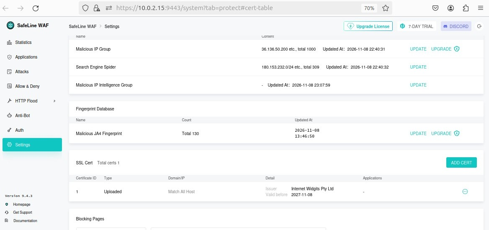

**Add the application:** under *Applications*, click **Add Application**:

| Setting          | Value                                      |
|------------------|--------------------------------------------|
| Domain           | `www.webserver.mazen`                      |
| Port             | `443`, **HTTPS** (no HTTP port added)      |
| SSL cert         | ID 1, the uploaded self-signed certificate |
| Mode             | **Reverse Proxy**                          |
| Upstream         | `http://192.168.56.104:8080` (Apache)      |
| Application name | `webserver.mazen`                          |

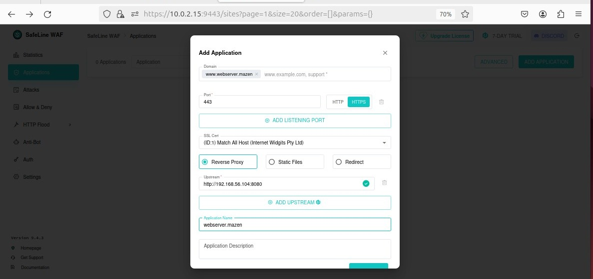

The application is created in **Defense** mode, listening on 443/HTTPS:

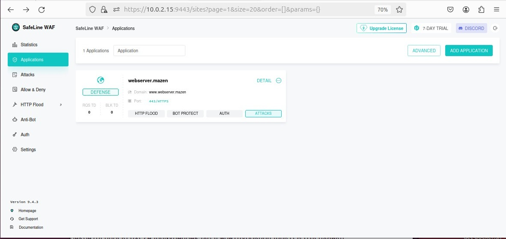

### 6. Verify access through the WAF

From Kali, open `https://webserver.mazen/DVWA` and log in. The request now passes through SafeLine before reaching Apache.

## Protection Tests

### Test 1: Custom deny rule (block a malicious IP)

A custom rule blocks every request from the attacker's IP, which simulates blocking a known malicious source. Under *Allow & Deny > Custom Rules > Blacklist*, I created a **Deny Rule**:

| Setting      | Value                        |
|--------------|------------------------------|
| Name         | `block_attack`               |
| Match target | Source IP **Equals** `192.168.56.106` |
| Monitor mode | Off: requests are blocked, not only logged |

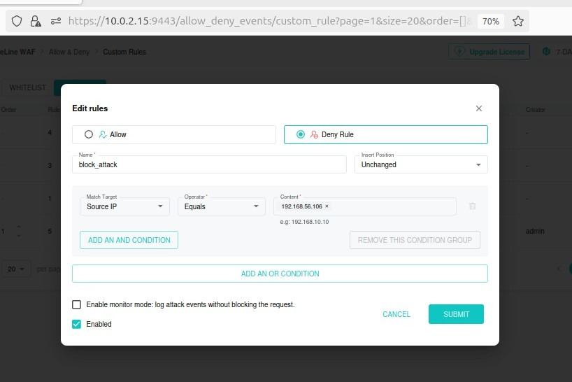

The rule sits at the top of the blacklist (order 1), alongside SafeLine's built-in rules for malicious IP groups and threat intelligence:

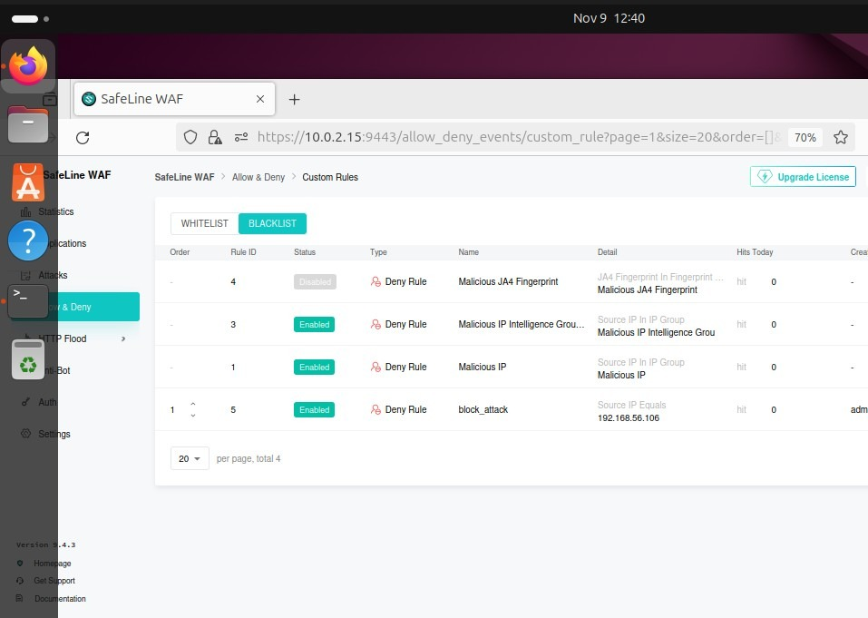

**Result:** Kali can no longer reach DVWA. SafeLine returns its **Access Forbidden** page with a request ID instead of forwarding the request, and the rule's hit counter rises to 4.

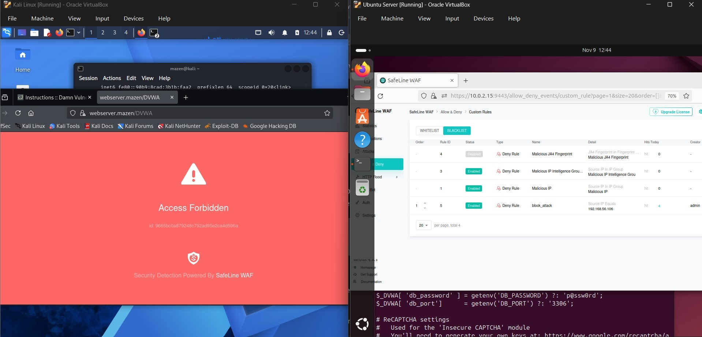

### Test 2: HTTP flood protection

The HTTP flood feature blocks a client that sends too many requests in a short time, a basic defence against application-layer (Layer 7) DoS and brute-force automation. Under *HTTP Flood > Rate Limiting*, I configured:

| Setting  | Value                 |
|----------|-----------------------|
| Duration | 10 seconds            |
| Access   | 5 requests            |
| Action   | **Block**             |
| Block    | 60 minutes            |

Any IP that sends more than 5 requests within 10 seconds is blocked for one hour.

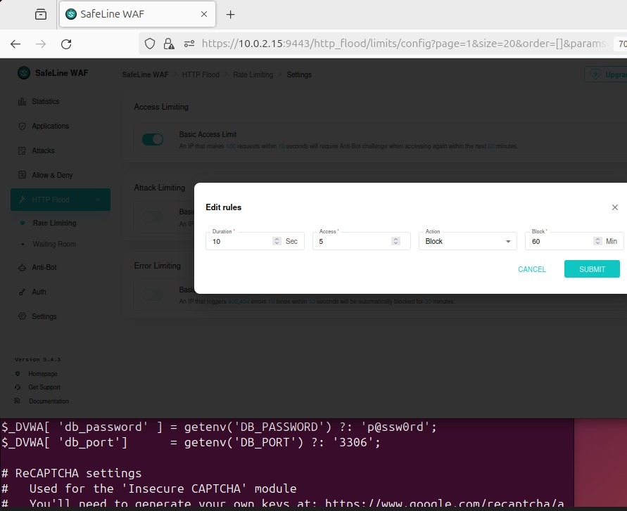

## Results

| Test                     | Expected                               | Result |
|--------------------------|----------------------------------------|--------|
| HTTPS-only application   | Only port 443/HTTPS configured on the WAF | ✅ Pass |
| Custom IP deny rule      | Requests from 192.168.56.106 blocked   | ✅ Pass, 4 hits |
| HTTP flood (5 req / 10 s)| Attacker IP blocked for 60 minutes     | ⚙️ Configured |

SafeLine's statistics dashboard summarises the traffic during the test:

| Metric        | Value   |
|---------------|---------|
| Requests      | 9       |
| Blocked       | 4       |
| Blocked rate  | 44.44%  |
| Unique IPs    | 1 (the Kali attacker) |

All 4 blocked requests match the 4 hits on the `block_attack` deny rule.

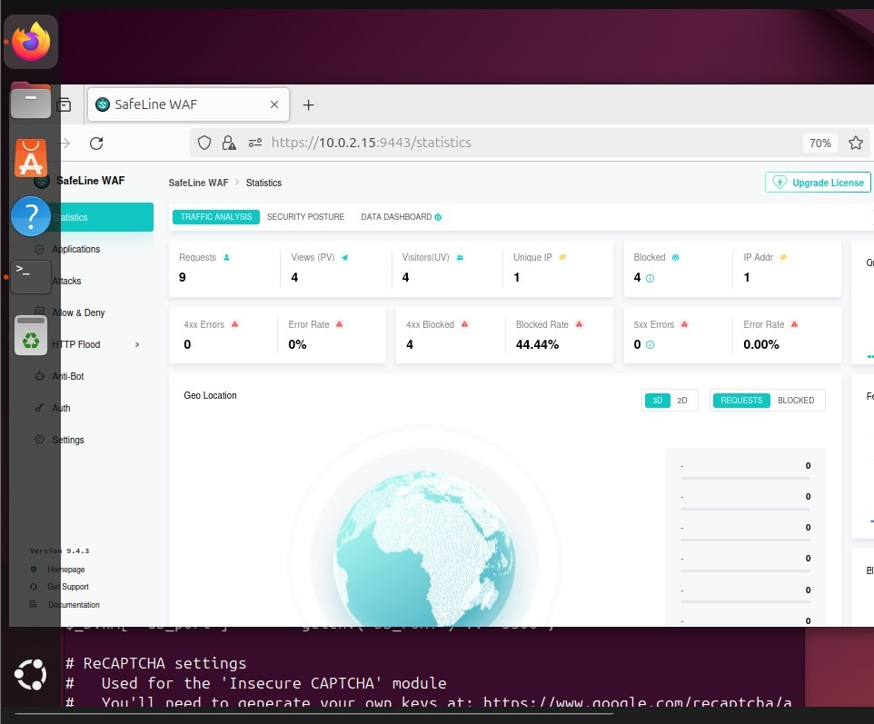

## Lessons Learned

- **A WAF only protects traffic that goes through it.** Apache still listens on port 8080 on the Host-Only network. Kali can open `http://webserver.mazen:8080/DVWA` directly, over plain HTTP, and bypass SafeLine completely. Requests made this way never show up as blocked in the WAF. In production, the backend must accept traffic only from the WAF, using `Listen 127.0.0.1:8080` or a firewall rule.

  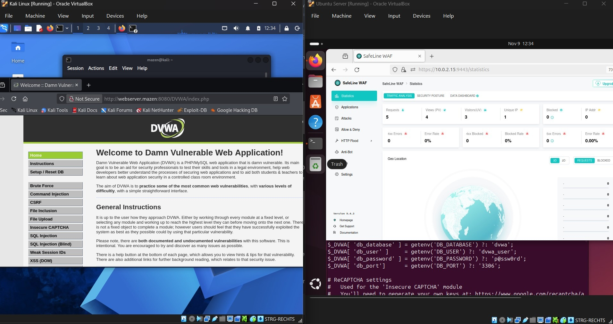
- **Port planning comes first.** SafeLine and Apache run on the same VM, so Apache had to move from 80 to 8080 before SafeLine could take over the web ports.
- **TLS terminates at the WAF.** The WAF can only inspect HTTPS traffic because it holds the certificate and private key. This is why certificate handling is part of WAF administration.
- **IP blocking is a blunt tool.** A deny rule stops a known source immediately, but attackers change IPs. Rate limiting (HTTP flood) and attack detection rules provide protection that doesn't depend on knowing the attacker in advance.
- **Kali's NAT connection may need manual setup.** If `eth0` has no DHCP connection, it must be created with `nmcli`.

## Skills Demonstrated

- Web application firewall deployment and configuration (SafeLine)
- Reverse proxy design and TLS termination
- PKI basics: private key, CSR and self-signed certificate with OpenSSL
- WAF policy: custom deny rules and HTTP flood (rate-limit) protection
- LAMP stack administration: Apache, PHP, MySQL on Ubuntu
- Vulnerable-application lab setup (DVWA) and safe lab isolation
- Virtual networking (NAT and Host-Only), local DNS with hosts files
- Documentation and reporting

---

*Author: Mazen Yousef | [LinkedIn](https://linkedin.com/in/mazenyousef) | [TryHackMe](https://tryhackme.com/p/mazen.yousef)*
